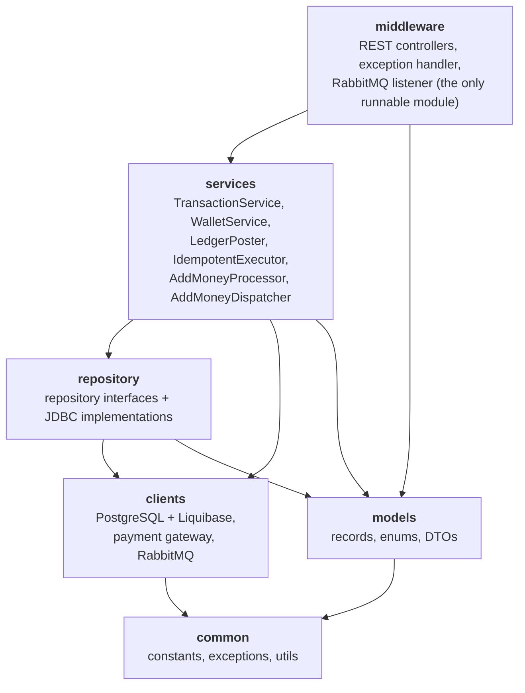
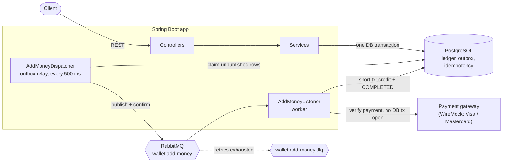
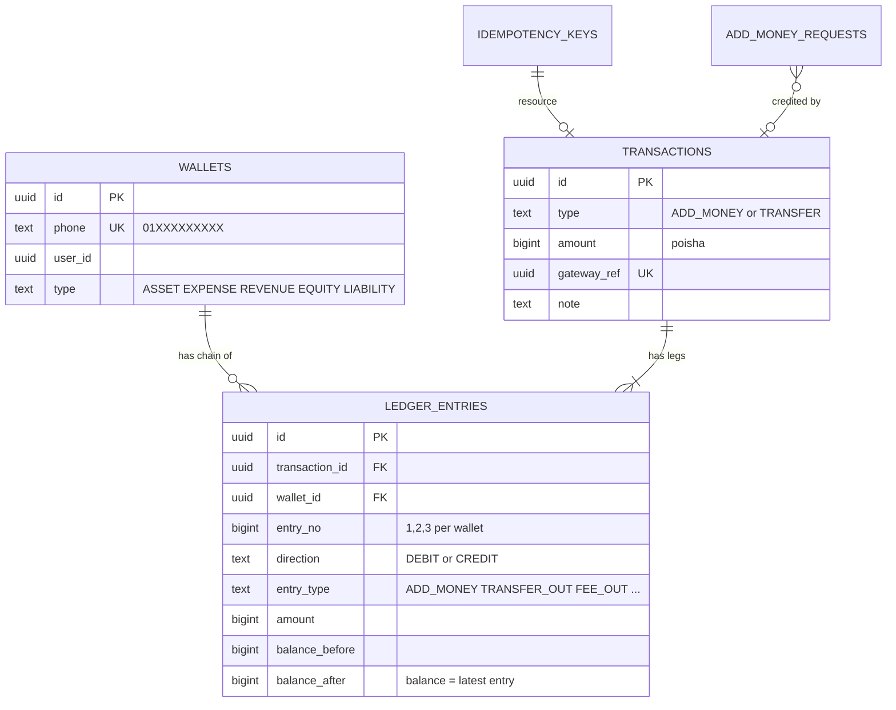
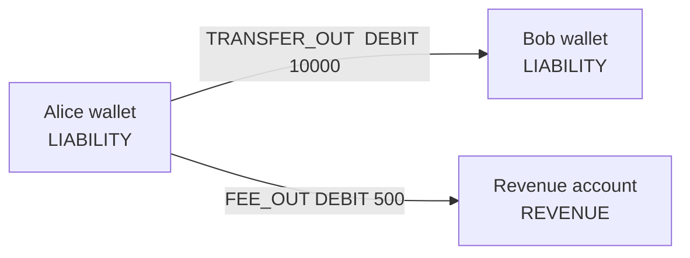
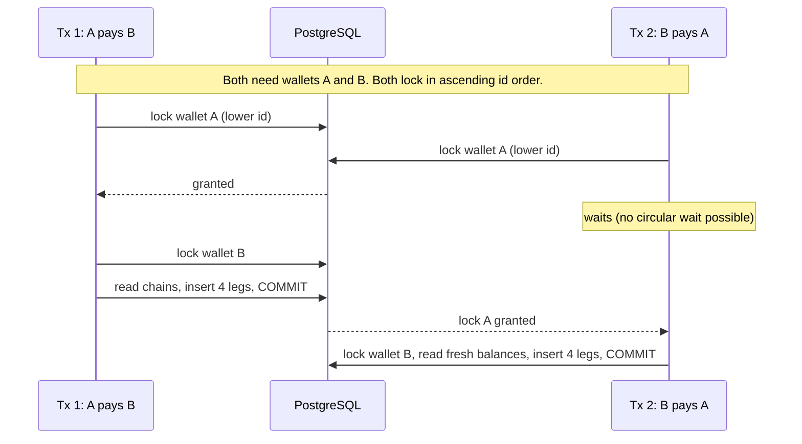
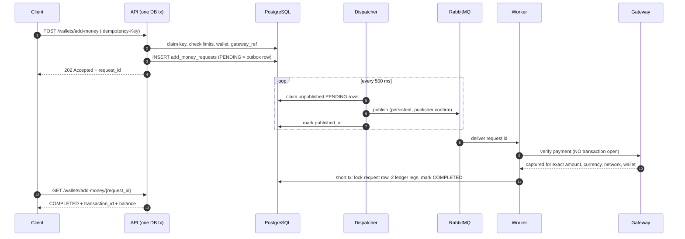
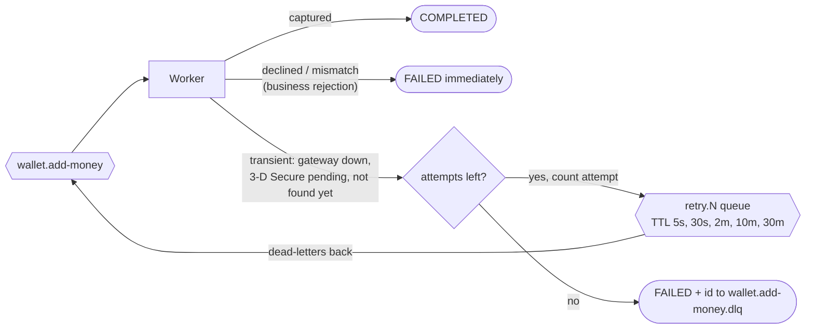

# Mini Wallet Service

A digital-wallet backend modeled on **Pathao Pay**: wallets, card top-ups through a payment gateway, and P2P transfers. Java 25, Spring Boot 4, PostgreSQL 18, RabbitMQ.

The assignment says *"correctness, safety of money operations, and clean engineering, not the number of features."* So the design question I optimised for was: **how do you make it impossible, not just unlikely, to lose, duplicate or invent money?**

```bash
docker compose up        # Postgres + RabbitMQ + payment-gateway mock + app on :8080
./mvnw test              # ~140 tests against real Postgres / RabbitMQ (Testcontainers)
```

---

## Contents

1. [What makes this solution different](#1-what-makes-this-solution-different)
2. [Quick start](#2-quick-start)
3. [Architecture](#3-architecture)
4. [Money safety: the ledger](#4-money-safety-the-ledger)
5. [Concurrency: no deadlocks, no overdrafts](#5-concurrency-no-deadlocks-no-overdrafts)
6. [Idempotency](#6-idempotency)
7. [Asynchronous add-money](#7-asynchronous-add-money)
8. [API reference](#8-api-reference)
9. [Testing](#9-testing)
10. [Assumptions and deliberate deviations](#10-assumptions-and-deliberate-deviations)
11. [What I would do next](#11-what-i-would-do-next)

---

## 1. What makes this solution different

| Typical solution | This one |
|---|---|
| `wallets.balance` column, `UPDATE balance = balance - ?` | **No balance column.** Balance is the `balance_after` of the wallet's latest ledger entry. Nothing mutable to corrupt. |
| Money correctness lives in service code | **PostgreSQL enforces it** with constraints and a deferred trigger: balanced debits and credits, no negative balance, gap-free per-wallet entry chain, append-only tables. A buggy service still cannot write a bad ledger. |
| Single-entry history rows | **Double-entry ledger** with account classes (`ASSET`, `LIABILITY`, `REVENUE`, ...). Customer balances plus revenue always equal the gateway clearing asset (a built-in trial balance). |
| Idempotency by "check, then insert" (racy) | Key claim, work and stored outcome are **one DB transaction**. Concurrent same-key requests serialize, so exactly one executes. |
| Add-money calls the gateway inside the request | **Outbox + RabbitMQ worker** with TTL-queue retries, a DLQ and publisher confirms. No dual write, and no DB lock held across a network call. |
| Mocks for external systems | Tests run against **real Postgres, real RabbitMQ and a WireMock gateway** with failure scenarios (declined, 3-D Secure pending, 503s, timeouts). |
| Fee, limits and rules hard-coded | Fees and limits are **rows in tables** (`fees`, `limits`), seeded by Liquibase. |

Concretely, the properties the code guarantees:

- A wallet balance can never go negative (DB `CHECK`, not just an `if`).
- A transfer is four ledger legs in one transaction. It commits entirely or not at all.
- Opposite concurrent transfers (A to B and B to A) cannot deadlock.
- N parallel transfers from one wallet can never overdraw it.
- The same `Idempotency-Key` executes once, even when requests arrive simultaneously.
- A `gateway_ref` credits a wallet at most once, however many requests or queue messages carry it.
- A crash at any point between "accepted" and "credited" loses nothing and double-credits nothing.

---

## 2. Quick start

**Prerequisites:** Docker and Docker Compose. (Java 25 and the `./mvnw` wrapper only if you run outside Docker.)

```bash
docker compose up --build
```

| Service | URL |
|---|---|
| API | http://localhost:8080 |
| Health | http://localhost:8080/actuator/health/readiness |
| RabbitMQ UI | http://localhost:15672 (`miniwallet` / `miniwallet`) |
| Payment gateway mock | http://localhost:8089 |
| PostgreSQL | `localhost:5432`, db/user/password `miniwallet` |

After editing an already-applied Liquibase changeset, reset local data with `docker compose down -v`.

### Try it in 60 seconds

```bash
H='Content-Type: application/json'

# 1. two wallets (type is explicit: customer wallets are LIABILITY)
curl -s -X POST localhost:8080/api/v1/wallets -H "$H" \
  -d '{"user_id":"0197a1c2-0000-7000-8000-000000000001","phone":"01711000001","type":"LIABILITY"}'
curl -s -X POST localhost:8080/api/v1/wallets -H "$H" \
  -d '{"user_id":"0197a1c2-0000-7000-8000-000000000002","phone":"01811000002","type":"LIABILITY"}'

# 2. top up 500 BDT (50000 poisha). Answers 202; a worker credits after the gateway confirms.
curl -s -X POST localhost:8080/api/v1/wallets/add-money -H "$H" -H 'Idempotency-Key: topup-1' \
  -d '{"phone":"01711000001","amount":50000,"gateway_ref":"3f1c9a52-7d4e-4b8a-9c21-5e6f7a8b9c0d","payment_method":"VISA"}'

# 3. balance (after a second)
curl -s localhost:8080/api/v1/wallets/01711000001/balance

# 4. transfer 100 BDT (the sender also pays the flat 5 BDT fee)
curl -s -X POST localhost:8080/api/v1/transfers -H "$H" -H 'Idempotency-Key: xfer-1' \
  -d '{"from_phone":"01711000001","to_phone":"01811000002","amount":10000,"note":"Lunch"}'

# 5. history, newest first
curl -s 'localhost:8080/api/v1/wallets/01711000001/transactions?page_size=10'
```

Replay step 4 with the same key and body: you get the identical response, with no second debit. Change the amount and keep the key: `422 IDEMPOTENCY_KEY_REUSED`.

The OpenAPI 3.1 spec is in [`docs/openapi.yaml`](docs/openapi.yaml).

---

## 3. Architecture

### Modules (compiler-enforced layering)



`middleware` depends on service **interfaces** only. Plain JDBC (`JdbcClient`) is used instead of an ORM so every locking statement and every SQL statement is visible and reviewable.

### Runtime topology



---

## 4. Money safety: the ledger

### Double entry, balance derived from the chain

Wallets hold **no balance**. Every money movement is one row in `transactions` plus its balanced legs in `ledger_entries`, both append-only.



Also: `fees`, `limits` (min/max per transaction type), `add_money_requests` (status record and outbox), `idempotency_keys`.

### What a transfer writes

A 100 BDT transfer from Alice to Bob with the 5 BDT flat fee (all amounts in poisha):



| Leg | Wallet | Direction | Amount |
|---|---|---|---|
| `TRANSFER_OUT` | Alice | DEBIT | 10000 |
| `FEE_OUT` | Alice | DEBIT | 500 |
| `TRANSFER_IN` | Bob | CREDIT | 10000 |
| `FEE_IN` | Revenue | CREDIT | 500 |

Debits (10500) equal credits (10500). Add-money is two legs: `GATEWAY_CLEARING` debit on the clearing asset account and `ADD_MONEY` credit on the customer. At any moment, **sum of customer balances + revenue = clearing asset**.

### The database is the last line of defence

Service code is careful, but the schema does not trust it. Liquibase changesets `002` and `003` enforce:

| Invariant | Mechanism |
|---|---|
| Debits equal credits; at least two legs | **Deferred constraint trigger**, checked at `COMMIT` |
| A transaction type has exactly its expected legs (`TRANSFER` = out, fee-out, in, fee-in; `ADD_MONEY` = clearing + credit) | Same trigger; legs cannot be added to a committed transaction |
| Ledger is immutable | Triggers reject `UPDATE` and `DELETE` on both tables |
| Per-wallet chain has no gaps or forks | `entry_no` is 1, 2, 3, ... and unique per wallet |
| Chain continuity | `balance_before` must equal the previous entry's `balance_after`; entry 1 starts at 0 |
| **Balance never negative** | `CHECK (balance_after >= 0)` |
| Arithmetic matches direction and account class | `CHECK` per `wallet_type` (debit-normal vs credit-normal) |
| Each leg type posts on its fixed side and class | `CHECK` on `entry_type` |
| A `gateway_ref` credits once | `UNIQUE` on `transactions.gateway_ref` |
| One wallet per phone, valid BD number | `UNIQUE` and `CHECK (phone ~ '^01[0-9]{9}$')` |

`LedgerIntegrityIntegrationTest` (27 tests) attacks these constraints with raw SQL: unbalanced inserts, forked chains, negative balances, updates, deletes. Each must be rejected by Postgres itself.

Money is `BIGINT` poisha end to end (`long` in Java, never `double` or `BigDecimal`). 1 BDT = 100 poisha.

---

## 5. Concurrency: no deadlocks, no overdrafts

`LedgerPoster` is the only place that moves money. For any operation it:

1. Locks every involved wallet row with `SELECT ... FOR UPDATE` **in ascending wallet-id order**.
2. Reads each wallet's latest ledger entry (its current balance) while holding the lock.
3. Checks the balance and appends the next entries to each chain, inside the same transaction.



Because everybody takes locks in one global order, a circular wait cannot form, so there are no deadlocks. Because balances are read after the lock, an overdraft race cannot happen: the second transfer sees the first one's result.

Also in place:
- **`lock_timeout=10s`** on application connections, so a pile-up on a hot row becomes `503 SERVICE_BUSY` with `Retry-After` and nothing written, instead of a hung request. `idle_in_transaction_session_timeout=60s` kills leaked transactions.
- The revenue and clearing accounts are locked in every transfer or top-up. That hot row is a deliberate trade-off for a strictly consistent trial balance. See [next steps](#11-what-i-would-do-next).
- `created_at` is `clock_timestamp()` at INSERT time, i.e. posting time under the locks. History sorts by `entry_no`, the true order, not by timestamp.

Proven by tests: `concurrentTransfersCannotOverdrawTheSender`, `oppositeTransfersBetweenTheSameWalletsDoNotDeadlockAndConserveMoney`, `concurrentCreditsToOneWalletAreAllApplied`.

---

## 6. Idempotency

Both add-money and transfers require an `Idempotency-Key` header (missing: `400`). The whole engine is `IdempotentExecutor`.


- **Exactly one execution under concurrency.** Claim, work and outcome are one transaction, so a second request with the same key waits on the first one's row and then replays its result. There is no "check then insert" window.
- **Request fingerprint** covers the normalized request (including `note`), so the same body in a different JSON shape is still the same request.
- **Deterministic failures are stored and replayed** with their original HTTP status. Transient failures roll the claim back, so a retry can succeed.
- A key identifies one attempt: a stored rejection is final for that key. After `INSUFFICIENT_BALANCE`, top up and retry with a **new** key.

---

## 7. Asynchronous add-money

A payment gateway is slow and unreliable, and the customer has already been charged by the time we call it. Holding a database transaction (and a wallet row lock) across that call would be a scalability and correctness trap. So `POST /wallets/add-money` only *accepts*; a worker does the credit.



**Why it is safe**

- **No dual write.** The message is published from the database row (transactional outbox), not from inside the accepting transaction. A crash between "accepted" and "queued" loses nothing; a `PENDING` request whose message is older than 10 minutes is republished as a safety net.
- **At-least-once delivery, exactly-once credit.** Duplicate deliveries are harmless: the worker locks the request row, skips anything not `PENDING`, and `transactions.gateway_ref` is unique as the last backstop.
- **The gateway must prove it.** The verify call carries the wallet's phone as `merchant_reference`; the gateway must echo it, and amount, currency and network must match. A payment captured for someone else is `PAYMENT_MISMATCH`.
- **Limits are checked once, at acceptance.** The customer has paid by the time the worker runs, so a limit change must not fail a paid request.

**Retries without sleeping threads**



Each retry queue's **TTL is the delay** and it dead-letters back to the work queue, so the broker does the waiting: no consumer, no `Thread.sleep`, and the wait survives restarts. Defaults give 6 attempts over about 43 minutes. Unexpected errors (bugs, DB errors) are counted too, so a poison message cannot loop forever. A DB lock timeout is re-parked **without** consuming an attempt, so contention alone cannot fail a paid request.

**Try the failure modes** with the WireMock gateway. The scenario is picked by the prefix of the `gateway_ref` UUID:

| `gateway_ref` starts with | Gateway behaviour | Result |
|---|---|---|
| *any other UUID* | Captured | `COMPLETED` |
| `00000402-` | Declined | `FAILED` `PAYMENT_DECLINED` |
| `00000202-` | 3-D Secure pending forever | retried, then `FAILED` `PAYMENT_PENDING` |
| `00000203-` / `00000503-` | Pending / 503 twice, then captured | retried, `COMPLETED` on 3rd attempt |
| `00000404-` | Unknown payment | `FAILED` `PAYMENT_NOT_FOUND` (after retries) |
| `00000422-` / `00000423-` | Wrong amount / another wallet | `FAILED` `PAYMENT_MISMATCH` |
| `00000500-` | Always 500 | retried, then `FAILED` `PAYMENT_GATEWAY_ERROR` |
| `00000504-` | Responds after 10 s (read timeout 5 s) | retried, then `FAILED` `PAYMENT_GATEWAY_ERROR` |

Reset the shared scenario counters with `POST localhost:8089/__admin/scenarios/reset`. Gateway requests need `X-Api-Key` (`visa-sandbox-key` / `mastercard-sandbox-key`), otherwise `401`.

---

## 8. API reference

Base path `/api/v1`. Full schemas: [`docs/openapi.yaml`](docs/openapi.yaml).

| Method | Path | Purpose | `Idempotency-Key` |
|---|---|---|---|
| `POST` | `/wallets` | Create a wallet (`user_id`, `phone`, `type`) | no |
| `GET` | `/wallets/{phone}` | Wallet details | no |
| `GET` | `/wallets/{phone}/balance` | Balance (latest ledger entry) and `updated_at` | no |
| `POST` | `/wallets/add-money` | Request a top-up; `202` + `request_id` | **yes** |
| `GET` | `/wallets/add-money/{request_id}` | Status: `PENDING`, `COMPLETED`, `FAILED` | no |
| `POST` | `/transfers` | P2P transfer; `201` | **yes** |
| `GET` | `/wallets/{phone}/transactions` | History: `type`, `from`, `to`, `page`, `page_size` (default 20, max 100), newest first | no |
| `GET` | `/transactions/{transaction_id}` | One transaction with all its legs | no |

**Consistent error format** for every failure:

```json
{ "error": { "code": "INSUFFICIENT_BALANCE", "message": "Wallet does not have enough balance for this transfer." } }
```

| Code | HTTP | Meaning |
|---|---|---|
| `VALIDATION_ERROR` / `INVALID_PAYLOAD` / `INVALID_ARGUMENT` | 400 | Bad body, field or parameter; the message names the field |
| `MISSING_IDEMPOTENCY_KEY` | 400 | Header absent |
| `INVALID_AMOUNT` | 400 | Outside the `limits` table range (default 100 to 2,500,000 poisha) |
| `INVALID_DATE_RANGE` | 400 | History `from` after `to` |
| `WALLET_NOT_FOUND`, `TRANSACTION_NOT_FOUND`, `ADD_MONEY_REQUEST_NOT_FOUND` | 404 | Unknown resource |
| `DUPLICATE_PHONE` (duplicate wallet), `DUPLICATE_GATEWAY_REF` | 409 | Uniqueness conflicts |
| `INSUFFICIENT_BALANCE`, `SAME_WALLET_TRANSFER`, `SYSTEM_WALLET_NOT_ALLOWED`, `IDEMPOTENCY_KEY_REUSED` | 422 | Business rule violations |
| `SERVICE_BUSY` | 503 | Lock timeout; nothing written, retry with the same key (`Retry-After`) |

The status of each code lives in one table (`GlobalExceptionHandler.STATUS_BY_ERROR_CODE`), so a **replayed** error keeps its original status. Failures only the worker can produce (`PAYMENT_DECLINED`, `PAYMENT_MISMATCH`, `PAYMENT_GATEWAY_ERROR`, ...) are stored on the add-money request as `error_code`, not returned by the POST.

**Health:** only `/actuator/health/liveness` and `/actuator/health/readiness` are exposed. Readiness checks the database and **deliberately ignores RabbitMQ**: with the broker down the service still accepts add-money (the outbox keeps the request), so it should stay in rotation.

---

## 9. Testing

```bash
./mvnw test                  # all modules; Docker must be running
./mvnw test -pl middleware   # integration tests only
```

About 140 tests. The integration tests use **Testcontainers** to start real PostgreSQL 18, RabbitMQ 4 and the WireMock gateway, apply the real Liquibase changesets and run the real services. No in-memory database, no mocked repositories.

| Area | What is proven |
|---|---|
| Ledger integrity (27) | Postgres rejects unbalanced, forked, gapped, negative and mutated ledger writes, raw SQL included |
| Transfers (25) | Atomic debit and credit, fee legs, insufficient balance, same-wallet, **no overdraft under concurrency**, **no deadlock on opposite transfers**, idempotent replay |
| Add-money (45) | Every gateway scenario, retries and DLQ, duplicate `gateway_ref`, **same key in parallel credits once**, parallel credits to one wallet all applied |
| Wallets and API (26) | Duplicate phone under concurrency (exactly one wallet), validation and error format |
| History (11) | Filters, paging, balance chain reads on |
| Others | Outbox dispatcher, health probes, phone and UUID utilities |

---

## 10. Assumptions and deliberate deviations

I read the assignment as the minimum contract and made some choices beyond it. These are the places where this solution differs from the examples in the problem statement, and why:

| Problem statement | This solution | Why |
|---|---|---|
| Wallets addressed by `wallet_id` (`w_8f3a...`) | Addressed by **phone number**; `wallet_id` is returned but never accepted | The phone is the identity a real wallet user knows. The id is an internal UUIDv7 used by the ledger. |
| "One user has one wallet", 409 on duplicate | **One wallet per phone**, `409 DUPLICATE_PHONE`; a `user_id` may own several wallets | Phone is the real uniqueness constraint in a mobile wallet; the same rule covers every wallet type. |
| `user_id: "u_1001"`, `gateway_ref: "GW-2026..."` | Both are **UUIDs** (non-UUID is `400`) | Matches the gateway's payment id format and lets the mock encode scenarios in the prefix. |
| Create-wallet response includes `balance` | Balance is a separate endpoint | There is no stored balance; it is derived from the ledger, so wallet details and balance are different reads. |
| Add-money responds with the credited result | Asynchronous: `202`, then poll | A real gateway verification is slow and can fail transiently. See [section 7](#7-asynchronous-add-money). |
| Add-money path `/wallets/{wallet_id}/add-money` | `/wallets/add-money` with `phone` in the body | Follows from phone identity. |
| Transfer moves `amount` | Sender also pays a **flat 5 BDT fee** (`fees` table); the max-amount limit applies to `amount` only | Demonstrates real double-entry with a revenue account. The fee is data, not code. |
| History types `ADD_MONEY`, `TRANSFER_OUT`, `TRANSFER_IN` | Adds `GATEWAY_CLEARING`, `FEE_OUT`, `FEE_IN` | The history lists ledger legs, so fee and clearing legs are visible. |
| `INSUFFICIENT_BALANCE` etc. | `422` for business-rule failures, `409` for uniqueness conflicts | Distinguishes "your request is wrong now" from "conflicts with existing data". |

Other assumptions:

- Currency is BDT only; amounts are integer poisha; limits are 100 to 2,500,000 poisha per transaction, stored in the `limits` table.
- Any valid Bangladeshi mobile number is accepted (`1XXXXXXXXX`, `01XXXXXXXXX`, `8801XXXXXXXXX` and `+8801XXXXXXXXX` all normalize to `01XXXXXXXXX`), with no operator-prefix restriction.
- Two **system accounts** are seeded (revenue and gateway clearing, owner `00000000-0000-7000-8000-000000000002`). They cannot send, receive or be topped up (`422 SYSTEM_WALLET_NOT_ALLOWED`).
- Pre-release schema policy: all data is test data, so changesets are edited in place instead of adding `ALTER` migrations.
- No authentication or authorization: it is out of scope for the assignment. Any caller may create any wallet type; role-based permissions would sit in front of that.

---

## 11. What I would do next

Honest list of what a production version would need:

- **Authentication and authorization** (callers own wallets; role-based wallet-type creation).
- **Hot-row contention:** the revenue and clearing accounts are locked on every operation. At scale, shard them into N sub-accounts or post fees in a batch, trading strict real-time trial balance for throughput.
- **Keyset pagination** for history instead of offset (offset paging is the current simple choice).
- **Observability:** metrics for outbox lag, retry-queue depth, DLQ size, lock-timeout rate; trace ids through the queue.
- **Idempotency-key expiry** (TTL cleanup) and a DLQ replay tool.
- **Reconciliation job** that verifies the trial balance and compares the ledger against gateway settlement reports.

---

## Repository layout

```
common/       constants, exceptions, utilities
models/       records, enums, DTOs
repository/   repository interfaces + impl/ implementations
clients/      Liquibase changelogs, payment-gateway client, RabbitMQ topology
services/     business logic (ledger, idempotency, add-money worker, rules)
middleware/   REST controllers, exception handler, listener (runnable)
docs/         problem-statement.md, openapi.yaml
wiremock/     WireMock stubs for the payment gateway
```
