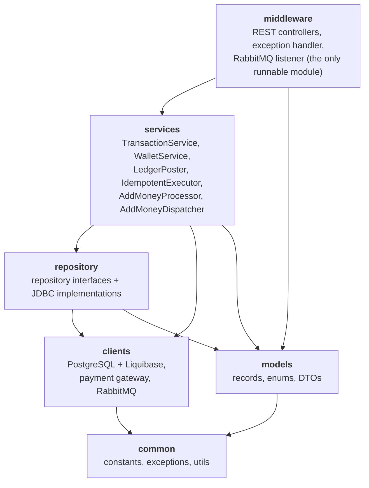
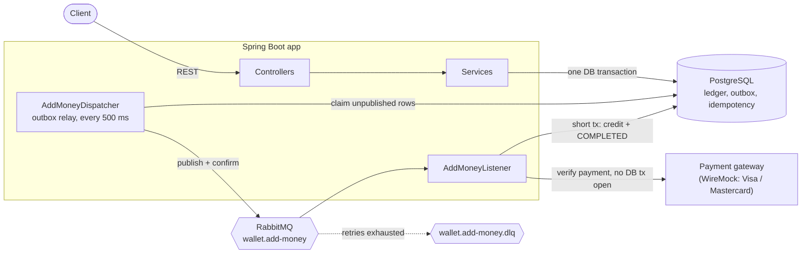
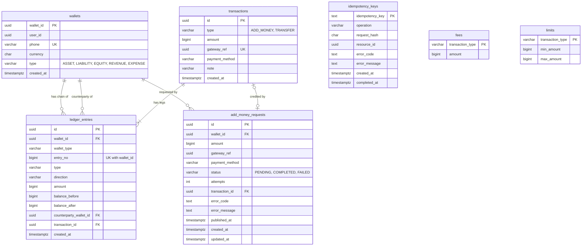
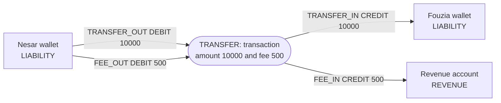
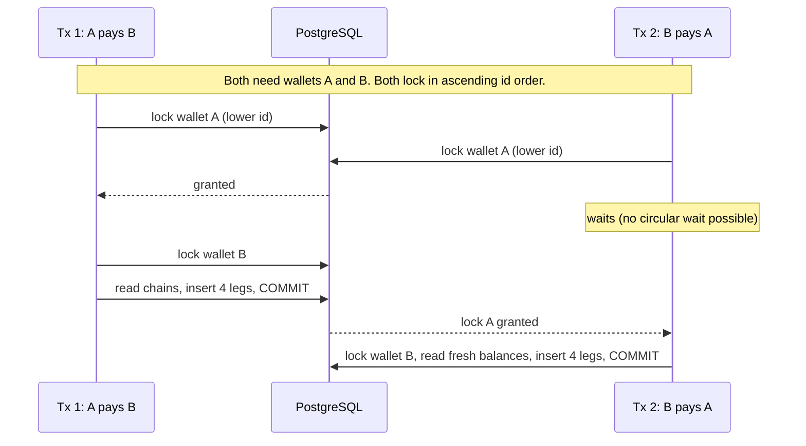
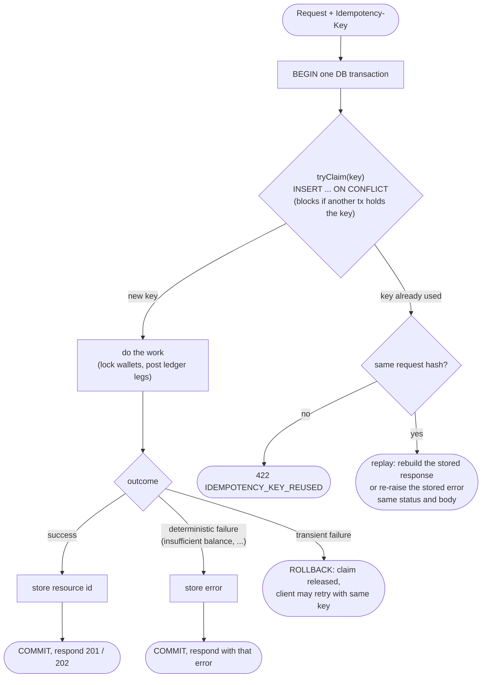
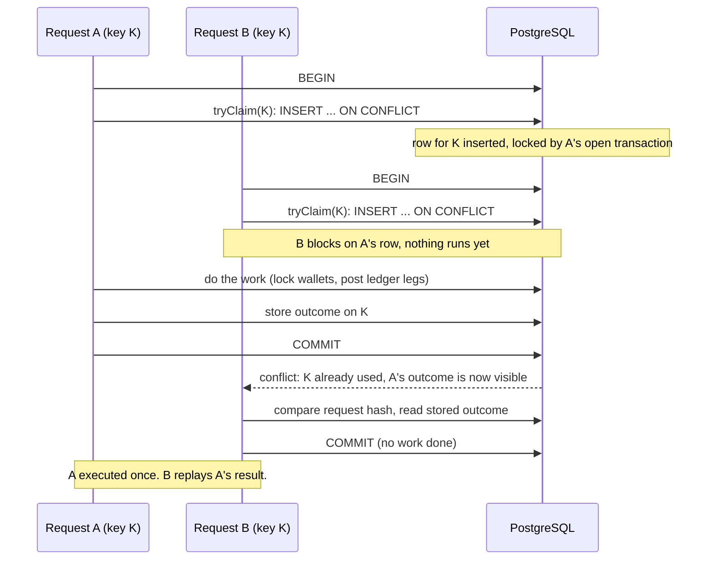
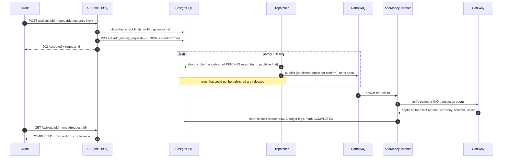
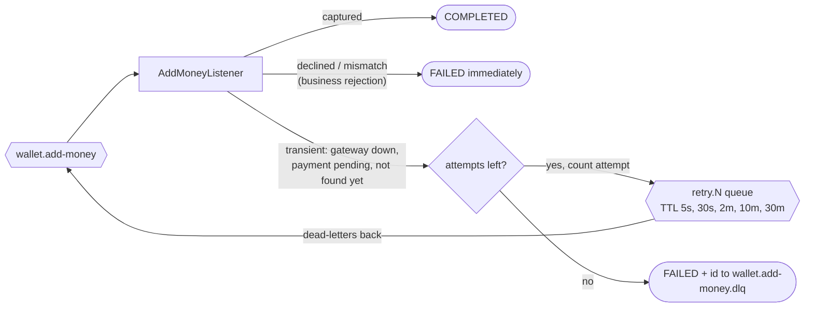

# Mini Wallet Service

A digital wallet backend built on one simple promise: money is never created from nothing, never changed silently,
never duplicated and never lost.

```bash
docker compose up              # start everything; the API is on http://localhost:8080
./mvnw test                    # ~180 tests against real Postgres / RabbitMQ (Testcontainers)
./load-test/run-benchmarks.sh  # run the k6 benchmark suite against the running service
```

The stack also uses these ports, so please keep them free: PostgreSQL `5432`, RabbitMQ `5672` (management UI on `15672`) and
the payment-gateway mock `8089`.

## Contents

- [Features](#features)
- [Technology and why](#technology-and-why)
- [What makes this solution different](#what-makes-this-solution-different)
- [API reference](#api-reference)
- [Architecture](#architecture)
    - [Modules](#modules)
    - [High Level Design](#high-level-design)
    - [Database entity diagram](#database-entity-diagram)
- [Money safety: the ledger](#money-safety-the-ledger)
    - [Double entry, balance derived from the chain](#double-entry-balance-derived-from-the-chain)
    - [What a transfer writes](#what-a-transfer-writes)
    - [The database is the last line of defense](#the-database-is-the-last-line-of-defense)
- [Concurrency: no deadlocks, no overdrafts](#concurrency-no-deadlocks-no-overdrafts)
- [Idempotency](#idempotency)
- [Asynchronous Add-Money](#asynchronous-add-money)
- [Load Testing Benchmark](#load-testing-benchmark)
- [Assumptions and deliberate deviations](#assumptions-and-deliberate-deviations)
- [What I could not make because of time constraints](#what-i-could-not-make-because-of-time-constraints)

---

## Features

- **Wallets**: create a wallet with a phone number (any valid Bangladeshi mobile, one wallet per phone), then read its
  details and its balance.
- **Add money**: an asynchronous card top-up through a payment gateway. The request is accepted with a `202`, and a
  background listener verifies the payment and credits the wallet. The status can be checked by polling with `request_id`.
- **P2P transfers**: move money from one wallet to another. The sender pays a flat fee, and this fee goes to a revenue
  account.
- **Transaction history**: per wallet, newest first, with type and date filters and paging.
- **Idempotency**: add-money and transfers take an `Idempotency-Key`. If a request is retried, the original result is returned
  and money is never moved twice.
- **Limits and fees as data**: the per-transaction min/max and the transfer fee are rows in the `limits` and `fees`
  tables, not hard-coded in the source code.
- **Failure handling**: gateway outages and pending payments are retried with backoff, then dead-lettered.
- **Operations**: liveness and readiness probes, an OpenAPI spec (`docs/openapi.yaml`) and a one-command Docker Compose
  stack.

## Technology and why

| Technology                                        | Used for                                    | Why this one                                                                                                                                                                                                                                                |
|---------------------------------------------------|---------------------------------------------|-------------------------------------------------------------------------------------------------------------------------------------------------------------------------------------------------------------------------------------------------------------|
| **Java 25**                                       | Language                                    | Widely used in fintech. Static typing catches mistakes at compile time, and the JVM is already proven under heavy concurrent load.                                                                                                                          |
| **Spring Boot 4** (Web MVC, Validation, Actuator) | HTTP API, request validation, health probes | The standard stack for Java services. It has built-in transaction management, validation and health probes.                                                                                                                                                 |
| **PostgreSQL 18**                                 | System of record                            | Real ACID transactions, row locks (`SELECT ... FOR UPDATE`), `CHECK` constraints and deferred constraint triggers. Together they allow the database itself to reject an unbalanced or overdrawn ledger.                                                     |
| **Plain JDBC** (`JdbcClient`), no ORM             | Data access                                 | In money code, every SQL statement and lock should be visible and easy to review. ORM dirty checking and lazy loading hide exactly the things which need to be explicit.                                                                                    |
| **Liquibase**                                     | Schema migrations                           | Versioned and repeatable schema, including the trigger functions which guard the ledger. It runs on its own connection at startup.                                                                                                                          |
| **RabbitMQ**                                      | Asynchronous add-money                      | Gateway verification is slow and can fail, so it should not run inside the request. TTL retry queues give delayed retries and a DLQ without writing a custom retry scheduler, and publisher confirms plus the outbox table make sure messages are not lost. |
| **Transactional outbox** (`add_money_requests`)   | Reliable publishing                         | A write to the database and a write to the broker cannot be atomic. So the outbox row is committed together with the business data, and a relay publishes it afterwards.                                                                                    |
| **WireMock**                                      | Payment gateway mock                        | Serves real HTTP with scripted scenarios (declined, pending, outage, timeout), selected by a `gateway_ref` prefix. The tests use the real client.                                                                                                           |
| **Testcontainers + JUnit 5**                      | Tests                                       | Integration tests run against real Postgres and RabbitMQ, so locking, triggers and retries behave the same as in production. Only the payment gateway is mocked (WireMock).                                                                                 |
| **UUIDv7** (`java-uuid-generator`)                | Identifiers                                 | Time-ordered, so new rows go near the end of the index (fewer page splits), and they can be safely generated in the application.                                                                                                                            |
| **Maven multi-module**                            | Build                                       | The modules (`common`, `models`, `repository`, `clients`, `services`, `middleware`) enforce the layering at compile time. Only `middleware` is runnable.                                                                                                    |
| **Docker Compose**                                | Local run                                   | One command starts the app, Postgres, RabbitMQ and the gateway mock.                                                                                                                                                                                        |
| **Lombok**                                        | Boilerplate                                 | Constructor injection, loggers and getters without writing boilerplate by hand. Records are used for data.                                                                                                                                                  |

---

## What makes this solution different

| Typical solution                                         | This one                                                                                                                                                                                                                                                                                              |
|----------------------------------------------------------|-------------------------------------------------------------------------------------------------------------------------------------------------------------------------------------------------------------------------------------------------------------------------------------------------------|
| `wallets.balance` column, `UPDATE balance = balance - ?` | **No balance column.** The balance is the `balance_after` of the latest ledger entry of the wallet, so there is nothing mutable to corrupt.                                                                                                                                                           |
| Money correctness lives in service code                  | **PostgreSQL enforces it** with constraints and a deferred trigger: balanced debits and credits, no negative balance, each wallet's entries numbered 1, 2, 3 with no gaps, and append-only tables. Even if the service has a bug, it cannot write a bad ledger.                                       |
| Single-entry history rows                                | **Double-entry ledger** with wallet types (`ASSET`, `LIABILITY`, `EQUITY`, `REVENUE`, `EXPENSE`). As every transaction balances, standard ledger checks like the trial balance and the accounting equation (assets + expenses = liabilities + equity + revenue) hold across all five account classes. |
| Idempotency by "check, then insert"                      | Key claim, work and stored outcome are done in **one DB transaction**. Concurrent requests with the same key wait in a queue, so exactly one of them executes.                                                                                                                                        |
| Add-money calls the gateway inside the request           | **Outbox + RabbitMQ listener** with TTL-queue retries, a DLQ and publisher confirms. There is no dual write, and no DB lock is held during a network call.                                                                                                                                            |
| Mocks for external systems                               | Tests run against **real Postgres, real RabbitMQ and a WireMock gateway** that simulates failure scenarios (declined, pending payment, 503s, timeouts).                                                                                                                                               |
| Fees, limits and rules hard-coded                        | Fees and limits are **rows in tables** (`fees`, `limits`), seeded by Liquibase.                                                                                                                                                                                                                       |

---

## API reference

Base path is `/api/v1`. Full schemas are in [`docs/openapi.yaml`](docs/openapi.yaml).

| Method | Path                              | Purpose                                                                                | `Idempotency-Key` |
|--------|-----------------------------------|----------------------------------------------------------------------------------------|-------------------|
| `POST` | `/wallets`                        | Create a wallet (`user_id`, `phone`, `type`)                                           | no                |
| `GET`  | `/wallets/{phone}`                | Wallet details                                                                         | no                |
| `GET`  | `/wallets/{phone}/balance`        | Balance (latest ledger entry) and `updated_at`                                         | no                |
| `POST` | `/wallets/add-money`              | Request a top-up; `202` + `request_id`                                                 | **yes**           |
| `GET`  | `/wallets/add-money/{request_id}` | Status: `PENDING`, `COMPLETED`, `FAILED`                                               | no                |
| `POST` | `/transfers`                      | P2P transfer; `201`                                                                    | **yes**           |
| `GET`  | `/wallets/{phone}/transactions`   | History: `type`, `from`, `to`, `page`, `page_size` (default 20, max 100), newest first | no                |
| `GET`  | `/transactions/{transaction_id}`  | One transaction with all its legs                                                      | no                |
| `GET`  | `/actuator/health/liveness`       | Liveness probe (outside `/api/v1`)                                                     | no                |
| `GET`  | `/actuator/health/readiness`      | Readiness probe: checks the database, ignores RabbitMQ (outside `/api/v1`)             | no                |

Every failure uses the **same error format**:

```json
{
  "error": {
    "code": "INSUFFICIENT_BALANCE",
    "message": "Wallet does not have enough balance for this transfer."
  }
}
```

| Code                                                                                                  | HTTP | Meaning                                                                                             |
|-------------------------------------------------------------------------------------------------------|------|-----------------------------------------------------------------------------------------------------|
| `VALIDATION_ERROR` / `INVALID_PAYLOAD` / `INVALID_ARGUMENT`                                           | 400  | Bad body, field or parameter; the message names the field                                           |
| `MISSING_IDEMPOTENCY_KEY`                                                                             | 400  | Header absent                                                                                       |
| `INVALID_AMOUNT`                                                                                      | 400  | Outside the `limits` table range (default 100 to 2,500,000 poisha)                                  |
| `INVALID_PHONE_NUMBER`                                                                                | 400  | Not a valid Bangladeshi mobile number                                                               |
| `INVALID_DATE_RANGE`                                                                                  | 400  | History `from` after `to`                                                                           |
| `WALLET_NOT_FOUND`, `TRANSACTION_NOT_FOUND`, `ADD_MONEY_REQUEST_NOT_FOUND`                            | 404  | Unknown resource                                                                                    |
| `DUPLICATE_PHONE`, `DUPLICATE_GATEWAY_REF`                                         | 409  | Uniqueness conflicts                                                                                |
| `INSUFFICIENT_BALANCE`, `SAME_WALLET_TRANSFER`, `SYSTEM_WALLET_NOT_ALLOWED`, `IDEMPOTENCY_KEY_REUSED` | 422  | Business rule violations                                                                            |
| `SERVICE_BUSY`                                                                                        | 503  | The service was busy and nothing was changed. Please wait a second and send the same request again. |

**Add-money errors:** these happen after the `202`, so the POST never returns them. The request ends as `FAILED` with
an `error_code`, which can be read from `GET /wallets/add-money/{request_id}`.

| Code                    | Meaning                                                       | Retried first?    |
|-------------------------|---------------------------------------------------------------|-------------------|
| `PAYMENT_DECLINED`      | The gateway declined the payment                              | no, fails at once |
| `PAYMENT_MISMATCH`      | The gateway's amount or wallet differs from the request       | no, fails at once |
| `PAYMENT_PENDING`       | The payment was still not captured when the retries ran out   | yes               |
| `PAYMENT_NOT_FOUND`     | The gateway did not know the payment when the retries ran out | yes               |
| `PAYMENT_GATEWAY_ERROR` | The gateway was down or timed out when the retries ran out    | yes               |
| `INTERNAL_SERVER_ERROR` | An unexpected error persisted when the retries ran out        | yes               |

When the retries run out, the request id is also sent to `wallet.add-money.dlq`.

---

## Architecture

### Modules



### High Level Design



### Database entity diagram



---

## Money safety: the ledger

### Double entry, balance derived from the chain

Wallets keep **no balance**. Every money movement is one row in `transactions` plus its balanced legs in
`ledger_entries`, both append-only.

### What a transfer writes

A 100 BDT transfer from Nesar to Fouzia with the 5 BDT flat fee (all amounts in poisha):



| Leg            | Wallet  | Direction  | Amount    |
|----------------|---------|------------|-----------|
| `TRANSFER_OUT` | Nesar   | DEBIT      | 10000     |
| `FEE_OUT`      | Nesar   | DEBIT      | 500       |
| `TRANSFER_IN`  | Fouzia  | CREDIT     | 10000     |
| `FEE_IN`       | Revenue | CREDIT     | 500       |
| **Total**      |         | **DEBIT**  | **10500** |
| **Total**      |         | **CREDIT** | **10500** |

### The database is the last line of defense

The service code is written carefully, but the schema does not depend on it. Liquibase changesets `002` and `003` enforce:

| Invariant                                                                                                                 | Mechanism                                                                             |
|---------------------------------------------------------------------------------------------------------------------------|---------------------------------------------------------------------------------------|
| Debits equal credits; at least two legs                                                                                   | Deferred constraint trigger, checked at `COMMIT`                                      |
| A transaction type has exactly its expected legs (`TRANSFER` = out, fee-out, in, fee-in; `ADD_MONEY` = clearing + credit) | Same trigger; legs cannot be added to a committed transaction                         |
| Ledger is immutable                                                                                                       | Triggers reject `UPDATE` and `DELETE` on both tables                                  |
| Each wallet's entries are numbered 1, 2, 3 with no gaps or duplicates                                                     | `entry_no` is 1, 2, 3, ... and unique per wallet                                      |
| Chain continuity                                                                                                          | `balance_before` must equal the previous entry's `balance_after`; entry 1 starts at 0 |
| Balance never negative                                                                                                    | `CHECK (balance_after >= 0)`                                                          |
| A `gateway_ref` credits once                                                                                              | `UNIQUE` on `transactions.gateway_ref`                                                |
| One wallet per phone, valid BD number                                                                                     | `UNIQUE` and `CHECK (phone ~ '^01[0-9]{9}$')`                                         |

**What the entry chain means.** Each wallet's ledger works like a bank passbook: every line has a serial number (`entry_no`)
and shows the balance before and after. A line must start from where the previous one ended.

| entry_no | what happened     | balance before | balance after |
|----------|-------------------|----------------|---------------|
| 1        | add money +500    | 0              | 500           |
| 2        | transfer out -100 | 500            | 400           |
| 3        | add money +200    | 400            | 600           |

- **No gaps:** 1, 2, 4 is rejected, because a missing line could hide a money movement.
- **No duplicates:** two entries cannot both be number 3 (for example two transfers at the same instant).
- **Continuous balances:** entry 2 must start at 500 because entry 1 ended at 500. Entry 1 always starts at 0.
- **Per wallet:** every wallet has its own numbering, starting at 1.

**The balance is simply the "balance after" of the last line, and by replaying the entries from 1 every past balance can be reproduced.**

---

## Concurrency: no deadlocks, no overdrafts

`LedgerPoster` is the only place where money is moved. For any operation it:

1. Locks every involved wallet row with `SELECT ... FOR UPDATE` **in ascending wallet-id order**.
2. Reads each wallet's latest ledger entry (its current balance) while holding the lock.
3. Checks the balance and appends the next entries to each chain, inside the same transaction.



As everybody takes locks in one global order, a circular wait cannot form, so there is no deadlock. As
balances are read after taking the lock, an overdraft race cannot happen: the second transfer sees the result of the first one.

---

## Idempotency

Both add-money and transfers require an `Idempotency-Key` header (if missing: `400`). The whole engine is in
`IdempotentExecutor`.



**Exactly one execution under concurrency:**



---

## Asynchronous Add-Money

A payment gateway is slow and unreliable, and the customer is already charged when we call it. Holding a
database transaction (and a wallet row lock) during that call would create scalability and correctness problems. So
`POST /wallets/add-money` only *accepts* the request; the credit happens later, when `AddMoneyListener` consumes the message and
calls `TransactionService.processAddMoney`.



**Why it is safe**

- **No dual write.** The message is published from the database row (transactional outbox), not from inside the
  accepting transaction. If a crash happens between "accepted" and "queued", nothing is lost; a `PENDING` request whose message was
  claimed more than 10 minutes ago is republished as a safety net (one waiting on a retry queue only after 10 minutes
  plus the longest retry delay).
- **At-least-once delivery, exactly-once credit.** Duplicate deliveries are harmless: the listener locks the request
  row, skips anything not `PENDING`, and `transactions.gateway_ref` is unique as the last backstop.
- **The gateway must prove it.** The verify call carries the wallet's phone as `merchant_reference`; the gateway must
  echo it, and amount, currency and network must match. A payment captured for another wallet is `PAYMENT_MISMATCH`.
- **Limits are checked once, at acceptance.** The customer has already paid when the listener runs, so a limit change
  must not fail a paid request.

**Retry Mechanism**



---

## Load Testing Benchmark

Benchmark of the service was done under heavy concurrent traffic using **k6** against the full Docker Compose stack on an
Intel Core i3-1115G4 with 8 GB RAM.

| Workload / Endpoint                         | Concurrency / Target |    Sustained TPS     | Avg Latency | p95 Latency | Success Rate |
|---------------------------------------------|:--------------------:|:--------------------:|:-----------:|:-----------:|:------------:|
| **Balance Inquiries (`GET /balance`)**      |       100 VUs        |    **~4,746 TPS**    |   12.8 ms   |   40.2 ms   |   **100%**   |
| **Extreme Read Stress (`GET /balance`)**    |       500 VUs        |    **~3,576 TPS**    |   85.6 ms   |   241.9 ms  |   **100%**   |
| **Target Arrival Rate (`GET /balance`)**    |  Up to 6,000 req/s   | **~3,054–4,800 TPS** |   64.9 ms   |   232.1 ms  |   **100%**   |
| **Wallet Creation (`POST /wallets`)**       |       100 VUs        |    **~2,019 TPS**    |   30.3 ms   |   69.1 ms   |   **100%**   |
| **Add-Money Ingestion (`POST /add-money`)** |        50 VUs        |    **~1,026 TPS**    |   27.6 ms   |   58.8 ms   |   **100%**   |
| **Add-Money Background Processing**         |      Background      |   **~90–100 TPS**    |    Async    |    Async    |   **100%**   |
| **P2P Transfers (`POST /transfers`)**       |        20 VUs        |     **~186 TPS**     |   68.2 ms   |   111.1 ms  |   **100%**   |
| **Mixed Production Workload**               |       300 VUs        |    **~1,290 TPS**    |   118.8 ms  |   291.6 ms  |  **99.7%**   |

---

## Assumptions and deliberate deviations

I treated the assignment as the minimum contract and made some choices beyond it. These are the places where this solution
differs from the examples in the problem statement, and the reasons:

| Problem statement                                        | This solution                                                                                                                                                                                                                                          | Why                                                                                                                                                            |
|----------------------------------------------------------|--------------------------------------------------------------------------------------------------------------------------------------------------------------------------------------------------------------------------------------------------------|----------------------------------------------------------------------------------------------------------------------------------------------------------------|
| Wallets addressed by `wallet_id` (`w_8f3a...`)           | Addressed by **phone number**                                                                                                                                                                                                                          | `wallet_id` is an internal system identifier. External parties can easily identify a wallet by its phone number.                                               |
| "One user has one wallet", 409 on duplicate              | **One wallet per phone**, `409 DUPLICATE_PHONE`; a `user_id` may own several wallets                                                                                                                                                                   | A system user may need to create multiple system wallets. Once role-based wallet creation is enabled, customers can be limited to only one `LIABILITY` wallet. |
| `user_id: "u_1001"`, `gateway_ref: "GW-2026..."`         | Both are **UUIDs** (non-UUID is `400`)                                                                                                                                                                                                                 | UUIDv7 guarantees uniqueness, so I could give my time to the other major parts.                                                                                |
| Create-wallet response includes `balance`                | Balance is a separate endpoint                                                                                                                                                                                                                         | There is no stored balance; it is derived from the ledger, so wallet details and balance are different reads.                                                  |
| Add-money responds with the credited result              | Asynchronous: `202`, then poll                                                                                                                                                                                                                         | Real gateway verification is slow and can fail temporarily.                                                                                                    |
| Add-money path `/wallets/{wallet_id}/add-money`          | `/wallets/add-money` with `phone` in the body                                                                                                                                                                                                          | It follows from the phone identity.                                                                                                                            |
| Transfer moves `amount`                                  | Sender also pays a **flat 5 BDT fee** (`fees` table); the max-amount limit applies to `amount` only                                                                                                                                                    | It demonstrates real double-entry with a revenue account. The fee is data, not code.                                                                           |
| History types `ADD_MONEY`, `TRANSFER_OUT`, `TRANSFER_IN` | Adds `GATEWAY_CLEARING`, `FEE_OUT`, `FEE_IN`                                                                                                                                                                                                           | The history lists ledger legs, so fee and clearing legs are visible.                                                                                           |
| `INSUFFICIENT_BALANCE` etc.                              | `422` for business-rule failures, `409` for uniqueness conflicts                                                                                                                                                                                       | This separates "your request is wrong now" from "conflicts with existing data".                                                                                |
| Phone format not specified                               | Any valid Bangladeshi mobile is accepted (`1XXXXXXXXX`, `01XXXXXXXXX`, `8801XXXXXXXXX` and `+8801XXXXXXXXX` all normalize to `01XXXXXXXXX`), with no operator-prefix restriction                                                                       | The phone is the wallet's external identity, so it has one canonical form.                                                                                     |
| System accounts not mentioned                            | A double-entry ledger needs system accounts (`ASSET`, `LIABILITY`, `EQUITY`, `REVENUE`, `EXPENSE`), but only `LIABILITY` wallets can top up or transfer. The other system accounts exist only to maintain the ledger (`422 SYSTEM_WALLET_NOT_ALLOWED`) | The double-entry flows need a revenue account and a gateway clearing account.                                                                                  |
| User verification not mentioned                          | Every `user_id` is assumed to be valid and to have completed eKYC, so wallet creation does not verify the user                                                                                                                                         | Identity verification is out of scope for the assignment.                                                                                                      |

---

## What I could not make because of time constraints

These are the things I could not complete in the available time, and a production version needs them:

- **Authentication and authorization** (callers own wallets; role-based wallet-type creation).
- **eKYC check before wallet creation:** verify the user's identity before a wallet is opened, instead of accepting any
  valid phone number.
- **Readable transaction ids:** short, human-friendly references such as `4CU91ANP2Q` instead of UUIDs, so customers
  can tell them to support.
- **Hot-row contention:** the revenue and clearing accounts are locked on every operation. At scale, shard them into N
  sub-accounts or post fees in a batch, trading strict real-time trial balance for throughput.
- **Separate read database:** stream ledger changes from PostgreSQL with Debezium and Kafka Streams into a second
  database that serves statement generation, balance checks and other read-heavy work, so that reads do not compete with
  the money-moving writes.
- **Keyset pagination** for history instead of offset (offset paging is the simple choice for now).
- **Observability:** metrics for outbox lag, retry-queue depth, DLQ size, lock-timeout rate; trace ids through the
  queue.
- **Idempotency-key expiry** (TTL cleanup) and a DLQ replay tool.
- **Reconciliation job** that verifies the trial balance and compares the ledger against gateway settlement reports.

